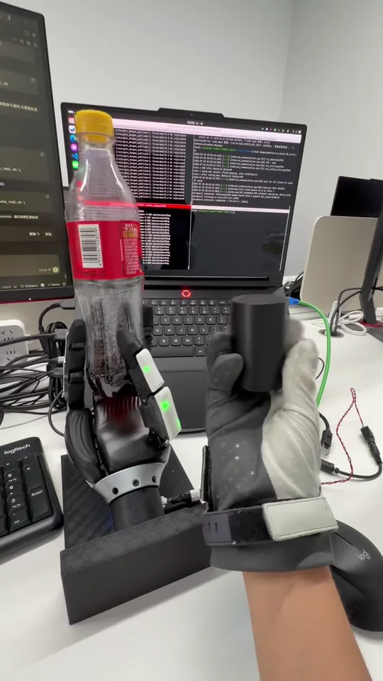

# XHand DexGen：学习辅助遥操作的手内旋转

本项目在 XHand Pro 灵巧手上跑通了 **DexGen 数据采集、生成模型训练、仿真验证与真机部署的完整链路**。系统不要求操作者逐关节精确遥控机械手，而是把 MANUS 手套作为上层意图输入，由学习得到的底层控制器完成稳定的顺时针旋转（CW）、逆时针旋转（CCW）和保持（HOLD）。

> 当前交付重点是“遥操作意图 + 学习控制”的手内旋转系统。仓库中原有的强化学习手内旋转代码仍然保留，但它现在主要承担 **上游专家策略与轨迹数据来源**，不再是 README 的唯一主线。

## 真机效果

[](internship_showcase/assets/dexgen-real.mp4?raw=1)

> ▶ 点击封面播放真机演示。也可以[直接打开或下载 MP4](internship_showcase/assets/dexgen-real.mp4?raw=1)。

## 项目完成了什么

```text
CW / CCW 强化学习专家
          │ rollout：状态、动作、关键点、触觉、物体状态、恢复标签……
          ▼
     双向旋转轨迹数据集
          │
          ├───────────────┐
          ▼               ▼
  Diffusion Policy       IDM
状态 + 模式 + guidance   状态 + 关键点运动
          │               │
          └──── 10 个关键点 ────► 21 维绝对 PD target
                                      │
MANUS 手套 ─► CW / CCW / HOLD 意图 ──┤
                                      ▼
                              仿真验证与 XHand 真机
```

目前已经完成：

- 训练并固化 CW、CCW 两个方向的强化学习专家策略；
- 使用专家策略 rollout 双向旋转数据，并加入噪声、域随机化和主动恢复样本；
- 训练关键点空间 Diffusion Policy 与 IDM（learned inverse dynamics model）；
- 完成无 guidance、RL 加噪声 guidance、MANUS guidance 三类仿真闭环验证；
- 完成 MANUS 上层意图与 `CW / CCW / HOLD` 状态机；
- 打通 IsaacLab → DexGen → Docker XHand SDK → EtherCAT 真机部署链路；
- 通过 Git LFS 交付当前正式模型与演示资产。

尚未完成的是 DexGen 中更通用的 **AnyGrasp-to-AnyGrasp**：从任意稳定抓姿出发，根据任意目标抓姿或操作意图完成多技能灵巧操作。当前仓库已包含 XHand 抓取数据集生成等前置工作，但对应的通用策略尚未训练成功。

## 为什么采用学习辅助遥操作

纯遥操作机械手并不等于把人手关节角直接复制给机器手。人手与 XHand 在关节拓扑、运动范围、连杆尺寸和接触几何上均不一致，因此必须经过重定向；通信延迟、手套噪声和操作者动作误差还会进一步放大接触不稳定。在手内旋转中，一次不合适的撤指或张掌就可能导致物体掉落。

本项目将控制分成两层：

- **上层意图层**：MANUS 表达旋转方向、继续操作或停止等低带宽意图；
- **下层技能层**：Diffusion 与 IDM 根据本体状态、触觉和关键点 guidance 生成稳定、连续的关节目标。

这样既保留人的决策能力，又把高频接触控制和掉落恢复交给从专家数据中学习到的控制器。

## 算法与数据路线

### 1. 强化学习专家：轨迹数据从哪里来

CW 与 CCW 专家是在 IsaacLab 中训练的手内旋转策略。它们不是最终部署时唯一的控制器，而是 DexGen 的 **数据教师**：采集器加载冻结的专家策略，在并行仿真环境中 rollout，并将每一步完整记录下来。

当前专家权重：

| 方向 | 权重 |
| --- | --- |
| CW | `ckpts/overnight_pose5/student_9402.pth` |
| CCW | `ckpts/overnight_ccw/student_9503.pth` |

双方向数据能让同一套生成模型区分旋转模式，避免只学习单一运动方向。采集时还使用动作噪声、物理域随机化和主动扰动恢复，使数据覆盖稳定旋转之外的偏离状态。

数据集保存的是 **完整轨迹信息**，包括关节状态、专家绝对 PD target、10 个关键点、五指触觉、物体位姿与速度、奖励、终止类型和恢复标签等。后续训练会按不同模型的输入/监督目标从这些字段中取子集；“Diffusion 只预测关键点”不代表数据集只保存关键点。

推荐采集入口：

```bash
conda activate env_isaaclab
cd /home/user/rotate_dexgen
./dexgen/pipelines/collect_recovery_dataset.sh all 0 9
```

数据集默认不随仓库交付，需按交接手册重新生成。详细分片、续跑和审计方法见 [DexGen 交接手册](dexgen/HANDOVER.md#4-rl-轨迹数据采集)。

### 2. 十个关键点：生成模型与机器人关节之间的中间表征

项目没有让 Diffusion 直接生成 XHand 的 21 维关节命令，而是在腕坐标系中选取 10 个关键点：五个 PIP 点和五个指尖胶垫点。每一帧关键点运动为 `10 × 3`，描述“每根手指应该向哪里移动”。

这层表征保留了抓取与接触几何，同时弱化了 XHand 特定关节结构对生成模型的绑定：

```text
轨迹中的 21 维关节状态
        │ 精确正运动学（FK）
        ▼
腕坐标系 10 × 3 关键点
        │ Diffusion 学习未来关键点运动
        ▼
当前状态 + 关键点运动
        │ IDM
        ▼
下一规划时刻的 21 维绝对 PD target
```

### 3. Diffusion Policy：生成未来关键点运动

Diffusion 使用最近 4 帧状态历史作为条件。正式配置中的单帧状态为 83 维：78 维本体状态加 5 个触觉标量；此外还输入 CW/CCW 模式和可选的外部 guidance。模型生成未来两个规划时刻的十关键点运动，并可通过 guided sampling 在“遵循 MANUS 意图”和“保持专家数据分布”之间进行调节。

### 4. IDM：从关键点运动还原为关节控制

IDM 接收当前状态和关键点运动，预测下一规划时刻的 21 维绝对关节 PD target。仓库中有时把它简称为“逆运动学模型”，但它并不是传统的解析 IK，而是从专家轨迹中训练得到的 **逆动力学模型（Inverse Dynamics Model）**。

Diffusion 和 IDM 必须保持 state dimension、history、prediction steps、关键点定义与触觉架构一致，不能混用不同实验版本的权重。

当前正式权重：

```text
dexgen/checkpoints/diffusion_modes_full_dr_active_recovery_v3_v2b_best.pt
dexgen/checkpoints/idm_modes_full_dr_active_recovery_v3_best.pt
```

### 5. 触觉条件与主动恢复

五指触觉不仅用于判断是否掉落，也作为模型状态的一部分。主动恢复数据会先对专家动作施加扰动，再记录干净专家如何重新建立接触并恢复目标方向旋转。正式训练混合稳定连续旋转数据与成功恢复窗口，因此模型能够看到接触力减弱、手指偏离和物体滑移等边界状态。

## 四种控制方式

| 模式 | 上层输入 | 下层执行 | 用途 |
| --- | --- | --- | --- |
| 无 guidance | CW/CCW mode | Diffusion → IDM | 正式生成策略闭环评估 |
| RL guidance | RL 专家动作加噪声后转为关键点 command | Guided Diffusion → IDM | 仿真功能、扰动与恢复测试 |
| MANUS guidance | 手套相对动作或手势意图 | Guided Diffusion → IDM | 学习辅助遥操作与真机部署 |
| 纯 MANUS | RetargetX 的 21 维目标 | 限位后直接 PD | 对照、预抓取与链路排查 |

自动模式下，持续张开手掌约 1 秒进入 `HOLD`：控制器锁存当前安全 PD target，并绕过 Diffusion/IDM，避免机械手照搬人的张掌而松开物体；恢复自然抓握后，系统继续进入 HOLD 前的 CW 或 CCW 方向。MANUS 断连或数据过期同样会进入安全保持。

## 快速开始

### 环境与大文件

推荐环境为 Ubuntu、NVIDIA GPU、Isaac Sim/IsaacLab 和 `env_isaaclab` Conda 环境。模型、演示视频等大文件由 Git LFS 管理，首次克隆后执行：

```bash
git lfs install
git lfs pull
```

完整环境版本、云端迁移与依赖安装见 [DexGen 交接手册](dexgen/HANDOVER.md)。

### 核心测试

```bash
conda activate env_isaaclab
cd /home/user/rotate_dexgen

python -m pytest tests/test_dexgen_pipeline.py -q
python -m pytest tests/test_manus_dexgen_bridge.py tests/test_dexgen_deploy.py -q
```

### 正式仿真闭环

CW 示例：

```bash
python dexgen/commands/eval/eval_dexgen.py \
  --diffusion dexgen/checkpoints/diffusion_modes_full_dr_active_recovery_v3_v2b_best.pt \
  --idm dexgen/checkpoints/idm_modes_full_dr_active_recovery_v3_best.pt \
  --mode cw --num_envs 16 --steps 1200 --ddim_steps 25 \
  --sensor_profile raw --so3 --device cuda:0
```

将 `--mode cw` 改为 `--mode ccw` 可评估逆时针方向。正式实验应固定配置并运行多个 environment seed 与 diffusion seed，不能用单次成功代替统计结果。

### RL 加噪声 guidance 仿真

```bash
python dexgen/commands/eval/eval_guided.py \
  --controller noisy_rl --mode cw \
  --diffusion dexgen/checkpoints/diffusion_modes_full_dr_active_recovery_v3_v2b_best.pt \
  --idm dexgen/checkpoints/idm_modes_full_dr_active_recovery_v3_best.pt \
  --sensor_profile raw --noise_alpha 0.1 \
  --steps 1200 --so3 --interactive_mode_switch --device cuda:0
```

运行中可用 `c` / `v` / `m` 切换 CW、CCW 或翻转方向，`i` 查看状态，`q` 安全退出。

## MANUS 与 XHand 真机部署

真机控制涉及 EtherCAT、机械限位和温度保护。首次操作请先阅读 [真机部署手册](dexgen/deploy/README.md)，并在手和物体下方放置承接平台。

### 终端 1：启动 MANUS 输入源

```bash
sudo docker exec ros2_dev supervisorctl restart manus_core_mini
sudo docker exec -it ros2_dev bash
```

进入容器后：

```bash
cd /root/xbot/algorithm/teleopx/retargetx-2.2.18
bash script/run_hand_manus_dexgen_source.sh
```

### 终端 2：启动 XHand SDK 服务

```bash
cd /home/user/rotate_dexgen
bash dexgen/deploy/run_xhand_sdk_server.sh
```

等待出现 `[hardware] listening on tcp://127.0.0.1:8031`。

### 终端 3：启动控制器

```bash
# 手动切换 MANUS / DexGen
bash dexgen/deploy/run_manus_dexgen_real.sh

# 或：MANUS 手势自动控制 CW / CCW / HOLD
bash dexgen/deploy/run_manus_auto_real.sh --guidance-strength 1000
```

常用按键：

| 按键 | 功能 |
| --- | --- |
| `e` | 缓慢张开、触觉标定并执行接触即停预抓取 |
| `Enter` / `n` | 启动 DexGen |
| `t` | 纯 MANUS 21 关节遥操作 |
| `h` 后 `a` | 标定并启动 MANUS guidance → DexGen |
| `w` | 暂停并 HOLD，再按一次恢复 |
| `d` | 停止遥操输入并保持当前安全目标 |
| `c` / `v` / `m` | CW、CCW、切换方向 |
| `i` | 显示输入、方向、MANUS 状态和最高温度 |
| `q` | 沿安全轨迹缓慢张开并释放物体 |
| `x` / `Ctrl-C` | 发送 mode 0、保存日志并退出 |

当前真机参数固定为 `mode=4, kp=10, kd=0.3, speed=0, torque=0`。不要在不了解硬件后果时修改增益、限幅、温度保护或退出轨迹。

## 仓库结构

```text
rotate_dexgen/
├── dexgen/                    # 数据、训练、评估、pipeline、真机部署与交接文档
│   ├── commands/              # collect / train / eval 入口
│   ├── pipelines/             # 可续跑的数据采集与训练流水线
│   ├── checkpoints/           # 当前正式 Diffusion / IDM 权重（Git LFS）
│   ├── deploy/                # XHand 真机服务、控制器和硬件说明
│   ├── docs/                  # 实验记录与设计说明
│   └── HANDOVER.md            # 接手人应优先阅读的完整手册
├── manus_dexgen_bridge/       # MANUS / RetargetX 与 DexGen 的输入桥接
├── rl_isaaclab/               # 上游 RL 环境、训练和教师/学生策略
├── source/rl_lab/             # IsaacLab 扩展、任务和机器人资产
├── ckpts/                     # CW / CCW RL 专家权重（Git LFS）
├── lightning-grasp/           # XHand 抓取数据集与 AnyGrasp-to-AnyGrasp 前置工作
├── internship_showcase/       # 项目展示页、图片和视频
├── tests/                     # DexGen、MANUS bridge 与部署回归测试
└── docs/                      # RL 原理课程、旧版演示与硬件说明
```

## 建议阅读顺序

1. [DexGen 项目交接与快速上手手册](dexgen/HANDOVER.md)：环境、数据契约、训练、评估、部署和排障；
2. [DexGen 运行手册](dexgen/README.md)：不同仿真/遥操入口及全部参数；
3. [XHand 真机部署手册](dexgen/deploy/README.md)：三终端启动、状态机与安全流程；
4. [项目目录说明](dexgen/docs/PROJECT_LAYOUT.md)：文件职责和本机/云端迁移约定；
5. [原强化学习手内旋转演示说明](docs/rl_demo_intro/RL_DEMO介绍.html)：上游专家策略与早期 Sim-to-Real 工作；
6. [项目展示页](internship_showcase/index.html)：DexGen、RL 与抓取数据集的图文视频总览。

## 当前边界与后续方向

当前版本证明了以下闭环可行：

```text
双方向 RL 专家
→ 轨迹数据与恢复样本
→ 关键点 Diffusion + IDM
→ MANUS 意图控制
→ XHand 真机 CW / CCW / HOLD
```

下一阶段的核心不是继续堆叠单一旋转演示，而是扩展到 AnyGrasp-to-AnyGrasp：完善多物体、多抓姿图数据，训练 grasp-to-grasp 上层规划/强化学习策略，并把当前旋转原语推广为可组合的多任务、多技能灵巧操作系统。同时需要补充更系统的真机长时统计、跨物体泛化、传感器标定漂移测试和安全故障注入。
